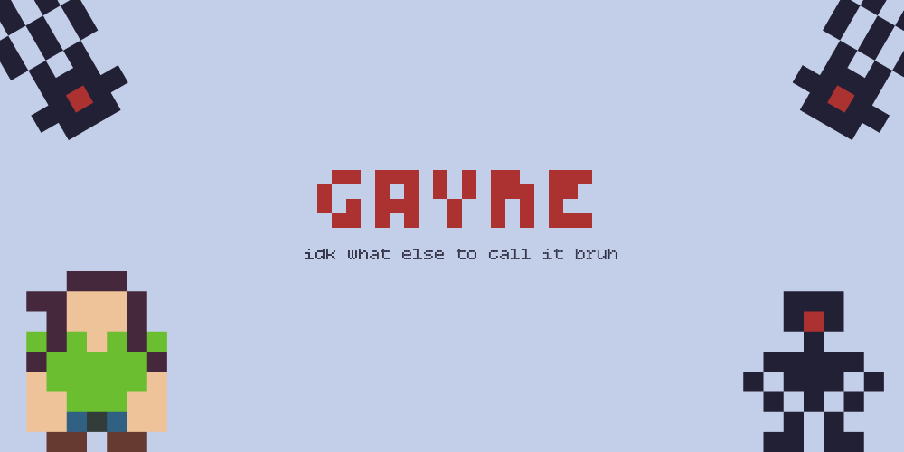

# sageui

this is the software side of [sage](https://github.com/istoocold/sage), a mini game esp32 based game console we're building.

the plan is to eventually have a basic home, app drawer and a game. at the time of writing this, i'm working on the game.

## features

- a desktop kinda home thingy (to be implemented)
- an app drawer (to be implemented)
- the game (being implemented)
  - main menu (to be implemented)
  - player
  - enemies (chaser and shooter)
  - score
  - lose menu (to be implemented, the game just ends when player dies)
  - shooting
  - sprites
  - aabb collision in bullets and enemies and all that

## how to build

the ui is built using circuitpython and displayio BUT it runs on computer using pygame. eventually when we physically build the thing, we'll swap out the keyboard inputs and stuff for actual physical buttons with gpios and stuff. so right now you can just clone the repo, install the dependencies and just run the main file with python.

## ai usage

used ai here and there for figuring out how the hell displayio works.
